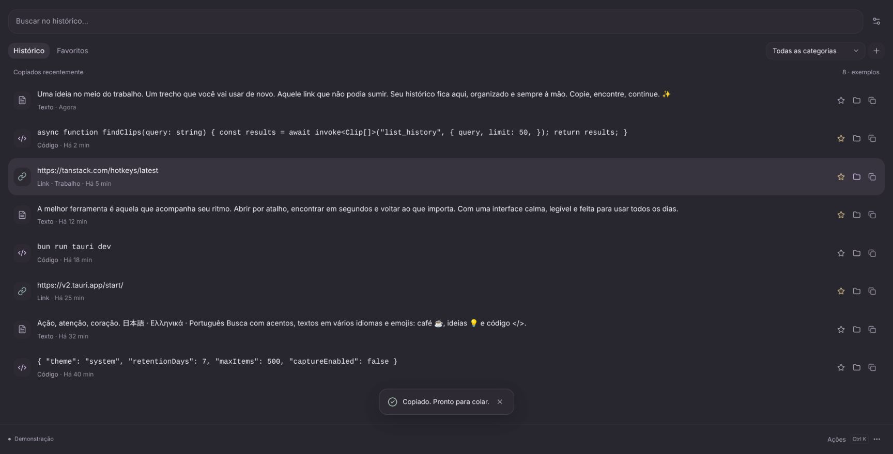

# Initial sizing and copy feedback

Historical iteration: the tray focus workaround and automatic popup-window fallback
below were removed by the [tray-copy visibility fix](tray-copy-without-window.md).

The native window starts hidden while its size is calculated, then opens with
90% of the active monitor's usable width and 90% of its usable height. Physical
sizes account for the monitor scale factor; the existing minimum size is clamped
on small monitors. Maximization is cleared. On Linux the requested size is
reasserted once after mapping to counter Mutter's automatic maximization of large
windows. Centering is requested, but Wayland owns final placement. Reopening from
the tray does not reset a size the user has adjusted during this run.

The search field now uses a search input without a leading magnifier. Search,
rows, dialogs and category controls have softer rounded corners. The category
filter is a native select with a custom rounded surface/caret, paired with a
matching category-management button. Native select keyboard behavior is retained.
The browser preview now fills its viewport to accurately exercise wide layouts.

Clicking an item's text copies the original payload. The Favorite and Category
buttons are independent and do not trigger copying. Double-click is no longer
assigned to preview; full preview remains in Actions and via Space on the grid.
Keyboard Enter and the individual Copy icon remain available. The redundant
footer Copy button has been removed.

An app copy keeps the window visible and shows a dismissible live-status popup,
"Copiado. Pronto para colar." Repeated copies renew its timeout. Success feedback
is only shown after the clipboard write resolves; failures display a distinct
informational notice. No copied payload is included in the feedback text.

After a successful tray copy, Linux calls the standard freedesktop Notifications
service with a fixed, payload-free summary/body. If the call fails or there is no
native notification adapter, the app opens and emits the same success popup.
The existing GNOME/Wayland focus requirement for tray copying is retained. OS
notification preferences, including Do Not Disturb, are respected.

## Verification

Frontend/native builds and Clippy passed. Eleven Rust tests passed, including
work-area sizing at normal and 200% scale, small-screen bounds and the notification
message's freedesktop D-Bus signature. Browser checks copied the exact synthetic
payload by clicking its text, displayed the success popup, found no footer Copy
button, and verified that Favorite/Category actions did not overwrite the fixture.
A wide layout was inspected at 1728 × 880. Desktop placement/size and visible
notification banners still require real-session inspection after restarting.

