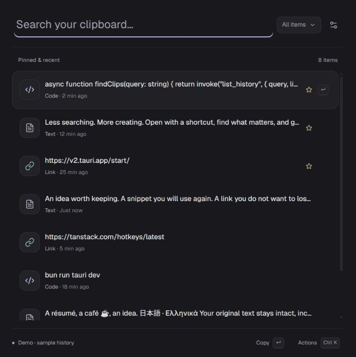

# Tuck 0.0.1 — command bar

Implemented on 2026-10-14 after the author ended further manual platform testing.
This replaces the earlier picker design; it does not certify new platform support.

## Delivered

- Inline cmdk command bar, single search field, pinned-first results, filter menu
  and item actions in Ctrl/Cmd+K; no history tabs or action buttons on each row.
- Tailwind 4/Vite, locally bundled Geist, Lucide icons, HeroUI Kbd hints and owned
  media/content/metadata rows inspired by shadcn Attachment. No remote image/font
  requests or upload features were introduced.
- TanStack Query owns the bounded native snapshot cache and mutation lifecycle;
  post-commit capture events invalidate it. TanStack Virtual bounds mounted rows.
  Native paging/FTS is still future work; React filters the current bounded history.
- Selection uses stable IDs, independent of the original payload. Arrow/Page keys
  traverse the complete result set, including offscreen rows; selected rows remain
  mounted for active-descendant semantics. Native text editing and IME are preserved.
  cmdk Vim bindings are disabled so Ctrl+K/P do not move selection before Hotkeys
  executes an action.
- Click or Enter copies the original text; successful copies show a dismissible
  popup. Pin, full preview, category assignment/management and deletion live in
  Actions. Filters include all items, pinned and existing user categories.
- Settings retains theme, opacity, platform-dependent blur and capture controls.
  Clear history confirms the operation and preserves pins by default; clear-all
  explicitly includes pins. SQLite transactions and committed cache/tray events
  use the same mutation path as individual deletion.
- Native OS frame, requested initial 90% work-area sizing and compact tray retained:
  three recent entries, quick pinned entries/View all, Open Tuck, Settings, Quit.
- Interface, accessible labels, relative dates, tray/notification text and native
  errors are English. Stored user text and category names remain unchanged.
- Product/window/browser branding is Tuck. Identifier and existing migration stay
  unchanged. MIT/OFL notices for newly added libraries/font are in `docs/licenses`.

## Verification

Biome format check, frontend production build/typecheck, eight Bun tests, fourteen Rust tests, Clippy
with warnings denied and native debug build passed. New SQLite coverage verifies
clear-unpinned preserves pins and clear-all removes history across reopen while
retaining categories. Existing fixtures still verify Unicode, migration and rollback.

Browser demo inspection confirms rendering, search, arrow selection, Ctrl+K without
changing selection, pin mutation/cache update and copy-success feedback. Demo
clipboard feedback is not a new native clipboard certification. Native clipboard
paths remain backed by the author's earlier GNOME confirmations; the new tray
translations/build compile, but no fresh OS-level tray test is claimed.

GNOME still captures on opening/focus without an extension, not continuously while
hidden. Windows/macOS manual adapters, global shortcuts, native blur support on
other platforms, screen-reader review and minimum webview support remain separate
work. No release/update endpoint exists; Settings reports that state in English.

Tray copying was subsequently changed to preserve visibility/focus on every outcome; see [tray-copy fix](tray-copy-without-window.md). Earlier manual copy/quit results do not certify the new Linux writer.
