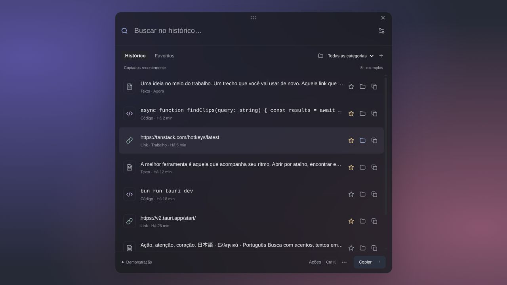

# Floating window, per-item actions and tray

Historical iteration: the native OS frame and a simpler tray now replace this window/menu design. See [current design](native-window-and-compact-tray.md).

The main Tauri window now uses `decorations: false`, `transparent: true` and
`shadow: false`. Its visible outline and rounded corners belong to the app CSS,
not to an OS titlebar. The small handle starts native dragging. Closing uses the
existing close-to-tray behavior, or quits if the desktop has no tray host.

Each history row provides Favorite, Categorize and Copy controls. These target
the clicked item directly rather than relying on a previous selection. The list
uses an accessible grid with action cells and roving tab stops; Enter on an action
button activates that button instead of the grid's copy action. Keyboard search,
copy and preview remain available. Text is rendered as inert text.

## Appearance

The background tint is adjustable from 20% to 100%, preserving opaque foreground
text and controls. Appearance preferences survive reopening through local webview
storage. The default is opaque. No system extension is installed.

Native blur uses Tauri's `set_effects`: Popover on macOS and Blur on Windows.
The OS controls the native material strength; it is an on/off setting, not a
pixel-radius promise. Application failures are reported in Preferences. These
native branches have not been verified on macOS or Windows hardware.

Linux is unsupported by Tauri's native effect API. In the current GNOME session
the app allows opacity adjustment but disables the native-blur checkbox with an
explanation. CSS `backdrop-filter` cannot blur unrelated desktop windows through
an ordinary webview. The browser preview demonstrates an HTML backdrop and says
explicitly that desktop behavior depends on the OS. Its screenshot is not proof
of native GNOME blur or a native tray menu.

References:
- https://v2.tauri.app/learn/window-customization/
- https://docs.rs/tauri/latest/src/tauri/webview/webview_window.rs.html (set_effects)
- https://v2.tauri.app/start/

## Tray menu

The native menu contains the latest three registered text previews, a Favorites
submenu (up to twenty quick entries plus access to all favorites), opening the
history, pausing/resuming recording, Preferences, About, Check for updates and
Quit. Entry selection copies its original text through the existing GTK adapter. On
GNOME/Wayland this briefly activates the panel to obtain focus before writing,
then hides it. If focus is denied, the app reports failure instead of pretending
the background write succeeded.
A missing item or copy failure opens the window with an explanatory message.
Menu refreshes follow capture/favorite/category/deletion changes; a revision guard
prevents an older snapshot from replacing a newer menu. Preview labels are single
line and bounded by Unicode characters. Recent and Favorite entries have distinct
menu IDs, even when the same item appears in both places.

Native menu styling is controlled by the desktop and cannot reproduce the
custom upload-card webview shown in the reference screenshot. Tauri does not emit
tray pointer events on Linux; the native context menu is the portable access path.
Tray presence still depends on an existing desktop host. Actual GNOME menu display,
tray clipboard ownership and borderless drag/hide behavior require a real-session
check. GNOME/Wayland capture remains limited to opening/focusing the app.

The user confirmed that there is no release repository/server yet. Check for
updates opens Preferences and states that updates are unconfigured. It does not
perform a network request, claim the version is current or download executables.
A signed updater endpoint is needed before implementing distribution updates.

Reference: https://v2.tauri.app/learn/system-tray/

## Coexisting with launchers

No OS-wide keyboard shortcut is registered, and internal hotkeys are scoped to
the app while focused. The app does not intercept another launcher's activation
shortcut. Future global activation should be opt-in, user-configurable, and
report registration conflicts rather than replace an existing binding.

The product focuses on original clipboard content: recover, favorite, organize,
and copy via the tray or compact list. It is intended to complement a launcher.
The implementation uses original code and existing licensed dependencies; no
Raycast, Maccy, CopyQ or tutorial source/assets were copied.

## Checks

Browser demo checks verified Favorite/Categorize/Copy on the intended row,
keyboard copy of a Unicode fixture, minimum/maximum opacity, browser blur toggle,
clear unconfigured-update feedback, and the small-window layout. Native Rust and
frontend builds and Clippy passed; nine Rust tests and eight Bun tests passed. Browser checks
do not prove native transparency/blur, tray appearance or behavior on another OS.

