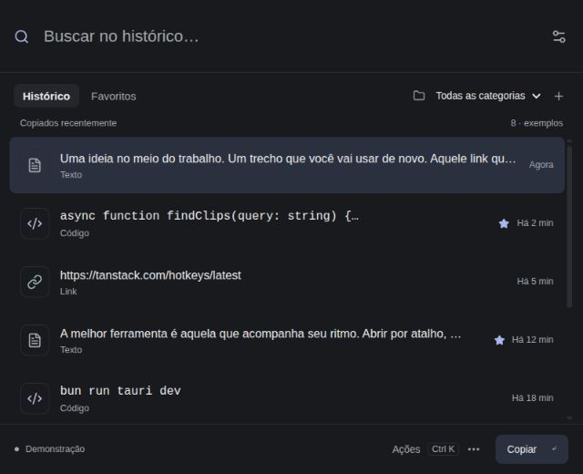

# Search palette and local history

The desktop UI is a compact 640 × 520 search palette accessed from the tray or
launcher. It has no sidebar or persistent preview pane. History and Favorites
share the same search; the category selector adds an optional second filter.
Preview, category assignment and deletion live in the Actions dialog. Categories
can be created, renamed and removed. Each item has at most one user category;
removing a category unassigns its items without deleting text or favorites.

Internal shortcuts: Ctrl/Cmd+F searches, Ctrl/Cmd+K opens Actions, Ctrl/Cmd+P
favorites an item with the list focused. Down from search enters the list;
Up/Down navigate, Enter copies from search or list, Space previews and Delete
removes an item only with the list focused. Escape clears search, then dismisses
the native window when tray access is available. Theme preference is remembered.
These are internal shortcuts, not OS-wide activation shortcuts.

## Local storage

Rust owns `history.sqlite3` inside Tauri's application data directory. The database
has versioned `clips` and `categories` tables. Text is preserved exactly in JSON
payloads; positions preserve recency and timestamps persist capture time. Search
currently runs over the bounded collection in React, with accent-insensitive,
case-insensitive matching and all search words required. FTS is not implemented.

A SQLite transaction commits text, favorites and categories before publishing
the updated snapshot/event. Failed writes leave the old state intact. Commands
and capture writes run on blocking workers; GTK clipboard callbacks remain on the
main thread. A newer unknown schema stops startup without resetting the database.
SQLite uses the bundled version supplied by rusqlite, so users need no separate
SQLite installation. On Unix the app data directory is restricted to its owner
and a newly created database uses mode 0600. The database is not encrypted.

Limits: 1 MiB per text, 500 total items, 16 MiB total text payload, 30 categories,
40 characters per category name. Exact duplicate copies move the existing item
up without losing favorites or categories. At the storage limit, the oldest
non-favorites are evicted. Favorites are preserved; if they fill the limit, the
new capture fails with an error. There is no automatic age-based deletion.
Deleting an item is a logical deletion, not a secure erase of SQLite storage.

The earlier in-memory prototype has no disk history to migrate. Persistence starts
with captures made by this version. Capture opt-in is retained in the existing
preference file. The browser demo stays labeled and uses synthetic session-only
history; it does not access the native database.

## Platform scope and originality

The current working clipboard adapter remains Linux GTK. GNOME/Wayland records
on opening/focusing the window, not continuously while hidden. No new GNOME
extension is required. Tray presence depends on the desktop's existing tray host;
without one the ordinary window/launcher remains usable. OS-wide shortcuts,
automatic paste, continuous capture and native macOS/Windows adapters remain
future work.

The UI and storage logic are original implementation. Raycast, Maccy, CopyQ and
the Rocketseat video are interaction/research references; their source and assets
were not copied. rusqlite 0.40.2 is MIT licensed; its license notice is preserved
in `docs/licenses/rusqlite-MIT.txt`. A complete dependency notice inventory is
still required before producing a distributable release.

## Verification

Eight Rust tests passed, eight Bun tests passed (four search tests and four tests
for the archived GNOME research bridge). Frontend and native builds passed, and
Clippy passed with warnings treated as errors.

Rust tests use synthetic clipboard fixtures and temporary databases, including:
reopening and preserving Unicode text/favorites/categories, persistent deletion,
category validation/rename/removal, failed-write rollback, rejecting a newer
schema without deleting data, exact deduplication, stale capture epochs, item
limits and preserving favorites. Frontend tests cover combined search/favorite/
category filters and Unicode preservation. Builds and Clippy are run separately.

Browser interaction checks use the explicitly labeled demo: accent-free search,
keyboard favorites, create/rename/remove category, combined filters, full preview,
empty search, Escape and Enter copying the exact fixture. The 640 × 520 and
420 × 380 layouts were inspected; the latter has no horizontal overflow.

The browser check does not validate native GTK/tray behavior. The user previously
confirmed actual clipboard-to-list operation in their normal session. The prior
isolated Wayland native smoke attempt timed out and is not claimed as passing.
A full native restart/tray check of this new version remains manual.

