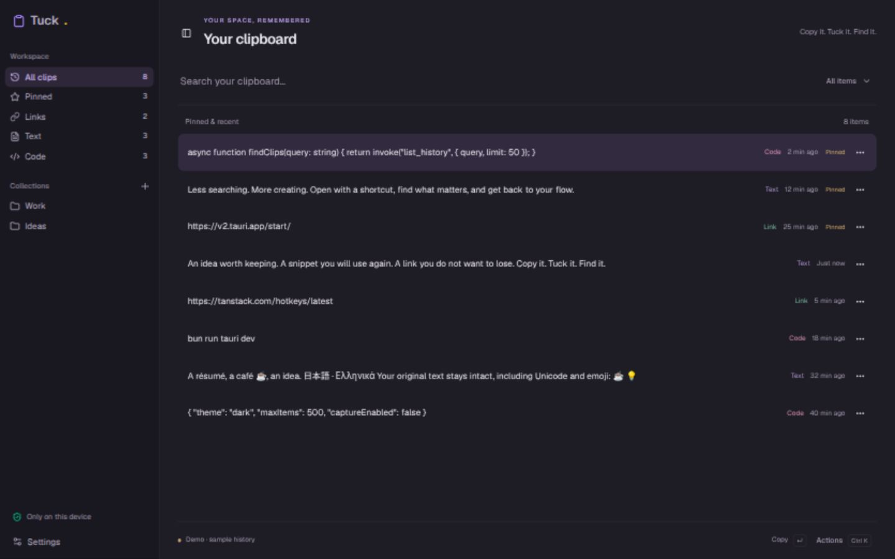
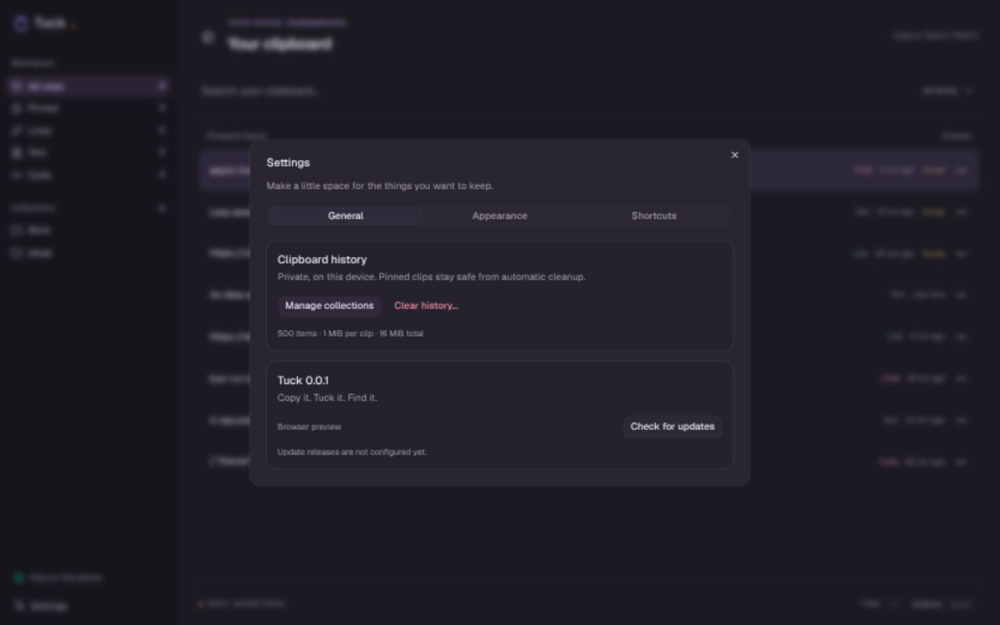

# Official shadcn integration — 2026-10-14

Installed through the official shadcn CLI: Base UI / Nova, sidebar-01 and the
button, button-group, dropdown-menu, dialog, sheet, tabs, card, input, checkbox,
switch, slider, select, label, separator and tooltip components. Source is owned
in `src/components/ui`; `app-sidebar.tsx` adapts the official block to Tuck's
real views and collections. The MIT notice is preserved in `licenses/shadcn-LICENSE.txt`.

The sidebar animates fully off canvas, with a persistent trigger in the workspace
and Ctrl/Cmd+B. Hidden desktop navigation is inert; mobile uses the Sheet drawer.
History rows use 14 px text without type icons, inline metadata, a pinned label
and the shadcn ButtonGroup / DropdownMenu action menu. cmdk and TanStack Virtual
retain search and keyboard navigation. Settings now uses General, Appearance and
Shortcuts tabs with cards and controlled shadcn switches, sliders and selects.
Geist is bundled; dialog and dropdown portals share the root theme tokens.
MIT notices for cn, class-variance-authority and tw-animate-css are also preserved.
HeroUI Kbd remains for the previously requested effective shortcut hints.

## Native tray hover

The accepted native tray and its independent copy path are unchanged. A hover
popover at the pointer position has **not** been implemented on Linux:
[Tauri TrayIconEvent](https://docs.rs/tauri/latest/tauri/tray/enum.TrayIconEvent.html#platform-specific)
explicitly documents that tray icon events are not emitted on Linux. The installed
GNOME AppIndicator D-Bus menu adapter forwards opened, closed and clicked events,
not per-item hover coordinates. Showing a webview above a native menu still needs
that missing event and item identity. Replacing the tray with a custom popup or
adding shell integration would change the accepted tray behavior; it cannot be
represented as a working native hover feature here.

## Verification

Production frontend build, TypeScript and 8 existing Bun tests pass. Browser
verification uses only synthetic demo history: full sidebar collapse/reopen,
row menu and collection submenu, Settings tabs and light/dark theme changes.
Native desktop hover is unsupported; no new native clipboard certification is
claimed. Vite reports a bundle-size warning, not a failed build.

## GNOME readability and motion follow-up

History text is now 16 px, search 18 px, metadata 13 px, navigation 15 px with
42 px hit targets. Sidebar width is 244 px with consistent group spacing, a
single brand lockup and restrained per-view icon colors. Text rows remain icon-free.
The virtual row estimate is 68 px to match the larger type.

The local GNOME preference `org.gnome.desktop.interface enable-animations` was
reported as false. The previous reduced-motion rule therefore suppressed transitions.
Tuck now has its own persisted Interface animations switch under Appearance,
enabled for the author's requested motion. No desktop setting is changed. The
sidebar uses explicit transform and width transitions (260 ms), independent of
Tailwind property registration. Switching animations off suppresses app motion.

## Search and sidebar finishing details

Search now has one straight underline on the search row, with reduced vertical
padding; focus recolors the same line. The toolbar filter uses the official
[Base UI Select](https://ui.shadcn.com/docs/components/base/select), with grouped
clipboard and collection options. Its controlled value shares the sidebar filter
state and resets the selected row on changes. The privacy footer reads “Your clips
stay here / Stored on this device”, with larger text and a quiet shield surface;
Settings uses Lucide's gear icon. Browser verification covered type and collection
selection without opening the previous filter dialog.
