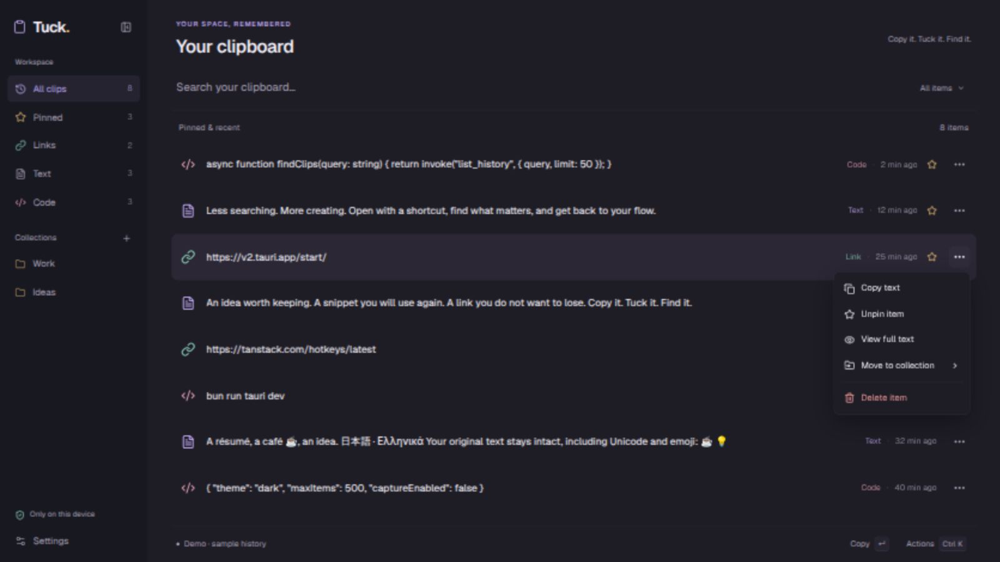

# Sidebar, larger text and per-item menus

Requested and implemented on 2026-10-14. Owned sidebar composition follows the
shadcn sidebar structure (header, grouped navigation, collections and footer),
with an explicit collapse/expand control and responsive icon rail. No copied block
assets or account/cloud features were introduced.

Geist typography is larger across navigation, history, metadata, controls and
dialogs. On wide windows, type/collection/time sit beside the main text; narrow
windows move details below to avoid crushing the content. Lucide item icons are
larger and remain unboxed. Selection keeps a soft tint, without the left border.

Each virtualized row has a sibling ButtonGroup with a three-dot trigger, outside
the cmdk option's copy target. Its accessible Base UI menu exposes Copy, Pin/Unpin,
Full text, Move to collection and Delete. Collection movement supports existing
categories, removing assignment and opening collection management. Direct item
arguments avoid acting on a previously selected row. Trigger focus is established
before changing cmdk selection to avoid closing a newly opened menu. Button/menu
keys do not bubble into the command bar's copy/navigation handlers.

Automatic app hover preview is removed: the author clarified that this was desired
for the tray. Explicit full-text preview is still available from menus/Ctrl+K.
The accepted native tray is unchanged. It exposes neither per-item hover events
nor webview-controlled font/translucency. A true hover preview would require a
separate app-owned tray popover and compatible click/position integration for the
GNOME tray host. This is not implemented or advertised as supported.

References: [shadcn sidebar](https://ui.shadcn.com/docs/components/base/sidebar),
[Button Group](https://ui.shadcn.com/docs/components/base/button-group),
[Base UI Menu](https://base-ui.com/react/components/menu). The blocks page exceeded
the web reader's size limit, so the official sidebar documentation was used.
ButtonGroup is original small owned composition; Base UI's notice is preserved in
`docs/licenses/`. Existing native clipboard/history adapters are unchanged.

Verification: frontend typecheck/production build and Biome formatting. Browser
synthetic demo checks cover opening a menu on a different row, Escape, moving a
single item to Work (one result), unpinning only that item (three pins to two), and deleting only one synthetic item (eight items to seven).

