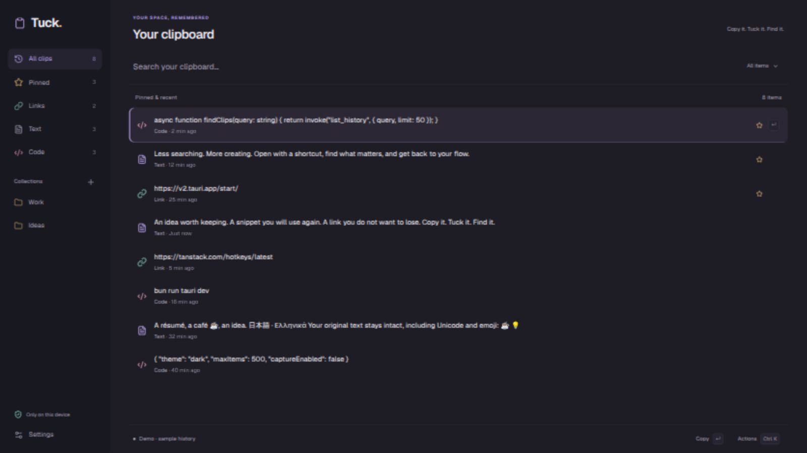

# Full-width workspace and tray prefixes

Historical iteration: the automatic app hover preview below was removed by the
[sidebar and item-menu iteration](sidebar-and-item-menus.md); explicit full-text preview remains.

On 2026-10-14 the author requested a calmer, more colorful full-window workspace,
with a Notion-inspired sidebar, Geist throughout, bare Lucide icons and previews.

The 1200 px content cap is removed. A responsive sidebar exposes history, pinned,
links, text, code and existing categories; small windows use an icon rail. Settings
lives in the sidebar. The search surface still uses cmdk and the list stays
virtualized. Geist is explicitly applied to app chrome, dialogs, inputs and preview
text. Native OS window decorations remain OS-controlled.

The palette uses lavender for active selection/navigation, mint for links and
capture state, amber for pins/collections and rose for code. Warm ivory is the
light counterpart. Item icons have no background tile or border; selection uses a
quiet tint and left accent. There is no user-data or clipboard-adapter change.

The app reveals a translucent, scrollable full-text preview after hovering a row
for 650 ms. Leaving, scrolling, changing results or copying dismisses it; Escape
also dismisses it. Content remains inert text, with no external fetch. Original
clipboard text is unchanged.

Native tray labels now keep the literal beginning, including URL scheme, instead
of reducing URLs to a hostname. Whitespace is compacted and the existing Unicode
width budget is retained, with ellipsis only after the preserved prefix. The tray
layout, native menu and independent no-window copy path are preserved.

**Native tray limits:** Tauri's menu items do not expose cross-platform per-item
hover/tooltip/font/opacity styling. In GNOME the exported menu is rendered by the
Shell/tray host. Webview CSS/Geist cannot restyle that menu. The full-text translucent
hover preview is implemented in the app, not claimed in the native tray. Controlling
those native-tray visuals would require replacing the accepted native menu or
changing the shell integration, not a global CSS tweak.

Verification: production frontend build and native checks; the tray-label regression
covers literal URL prefix preservation and Unicode bounds. Browser inspection at
1600 × 900 confirmed Geist loaded and a 1306 px bar within a 1382 px workspace,
plus Links filtering. This is not a claim of a new OS-level tray hover feature.

